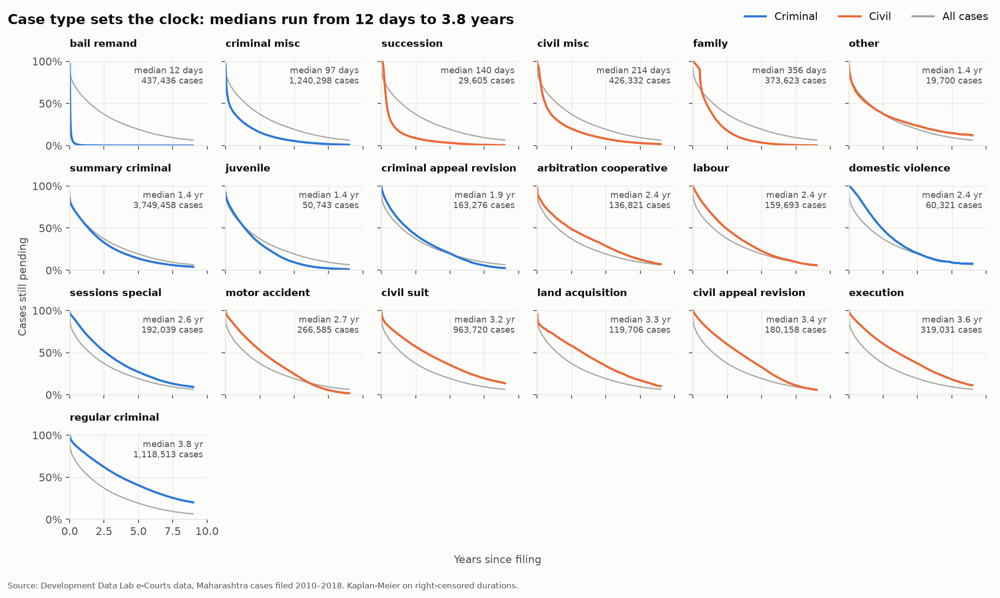
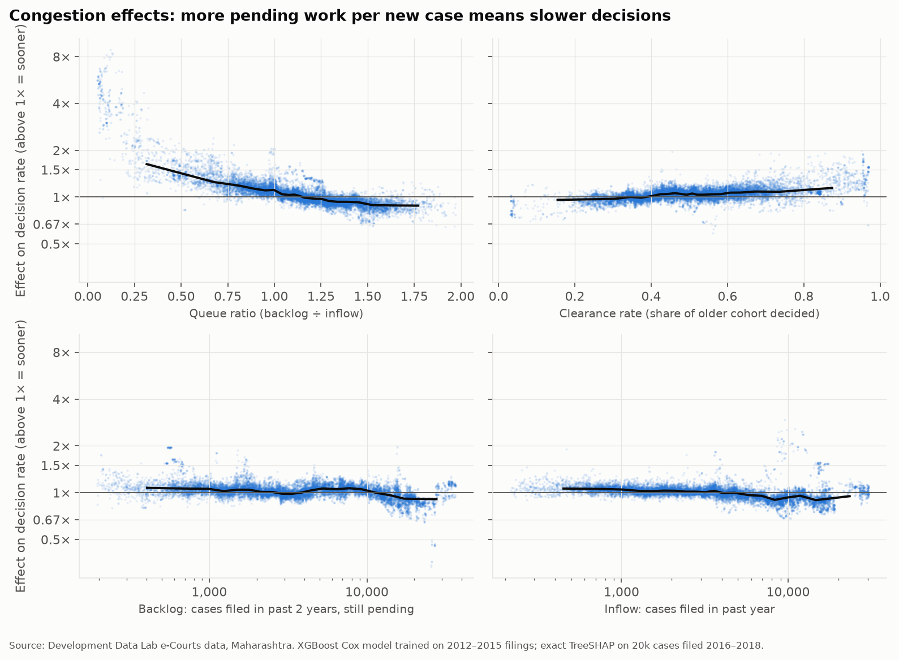

# How Slow Is Justice? Predicting Case Duration in India's Lower Courts

A data science project that models **how long cases take** in India's district courts, using
survival analysis on the Development Data Lab (DDL) e-Courts dataset (81M cases, 2010–2018).
Scope: **Maharashtra** (one state keeps the data laptop-sized).

> The question is *how slow the system is*, not whether any individual litigant or judge is
> "good" or "bad". The model predicts duration from structural features (court, district, case
> type, court congestion). It does not predict who wins.

## Why this project is different
Many cases were **still pending** when the data was collected. Dropping them would bias every
estimate toward fast cases, because only the cases that already finished would remain. These
cases are **right-censored**: we know they lasted *at least* N days. Survival analysis
(Kaplan-Meier, Cox PH, gradient-boosted survival models) handles them correctly.

## Censoring, in plain English
Suppose a case was filed in March 2016 and was still open when the data was collected in early
2019. We don't know how long it will take, but we do know it took **at least 2¾ years**. That
"at least" is called **right-censoring**.

There are two easy mistakes:
- **Drop the open cases.** Only finished cases are left, and those are the faster ones. In this
  data the median for decided cases only is 233 days. The true median is about 536 days.
- **Treat "still open" as "finished today".** This cuts every slow case short and again makes
  courts look faster than they are.

Survival analysis does neither. **Kaplan-Meier** asks a question for each day: of the cases
still open that morning, what share got decided that day? Multiplying those daily shares together
gives the share of cases still pending after *t* days. A censored case counts for every day it was
known to be open, then leaves the calculation without being counted as decided. The **Cox model**
uses the same idea to compare groups, for example "cases in district A are decided 1.3× as fast
as in the average district, for the same case type".

Two practical choices: observation ends on 2018-12-31, because most records were last updated
in mid-February 2019 and later decisions are largely missing ([D-016](docs/DECISIONS.md)). Cases pending for 9+ years are kept, because most still have
regular hearings ([D-012](docs/DECISIONS.md)).

## Results
10,007,058 Maharashtra cases filed 2010–2018, observed until 2018-12-31.

### How long cases take
- **The median case takes 536 days (1.5 years).** Counting only decided cases gives 233 days,
  2.3× too short, because the cases still pending are the slow ones. After 1, 3 and 5 years,
  57%, 33% and 19% of cases are still pending.
- **Case type sets the clock:** bail applications are decided in a median of 12 days, civil suits
  in 3.2 years, regular (warrant) criminal cases in 3.8 years. Executing a decree (3.6 years) takes
  longer than the suit that produced it.
- **Districts differ even for the same case type.** After adjusting for case mix with a Cox model
  stratified by case type, cases in Gadchiroli are decided 1.8× as fast as in the average district
  and cases in Thane 0.63× as fast.
- **Courts are getting slightly faster:** the share decided within a year rose from 37% to 49%
  for criminal cases and from 27% to 39% for civil cases (2010 vs 2017 filings).
- **The data stops in February 2019.** Recorded decisions fall from about 110k a month to 10k after
  that, so analysis ends on 2018-12-31. Using the dataset's nominal 2020 end date would have
  added a year of phantom waiting time ([D-016](docs/DECISIONS.md)).



### Predicting duration
Trained on 2012–2015 filings and tested on 2016–2018 filings, scored up to two years after filing
(Uno's C-index: share of case pairs put in the right order; integrated Brier score: prediction
error, lower is better).

| model | C-index | integrated Brier |
|---|---|---|
| Kaplan-Meier curve of the case type (baseline) | 0.651 | 0.200 |
| Cox, stratified by case type | 0.692 | 0.188 |
| XGBoost AFT (log-normal) | 0.696 | 0.197 |
| **XGBoost Cox** (used by the app) | **0.699** | **0.188** |

Court, district and congestion features add about 0.05 C-index over case type alone. Boosting adds
little over a linear Cox model. Court congestion, measured as features at the filing date
(cases filed in the past year, cases from the past two years still pending, and how much of an
older cohort the court has cleared), is the second most important input after case type.

### What drives delay
SHAP values of the boosted model: case type accounts for 44% of the explanation, court congestion
for about 30% and district for 13%. A court whose pending cases are a quarter of its yearly intake
decides cases about 1.6× as fast as average; one with 1.5 years of work waiting, about 0.9×.



### Limitations
- Data ends in early 2019, so predictions describe late-2018 court conditions. Recent filings were
  decided slightly faster than the model predicts.
- The app's model is refit on all 2012–2018 filings; its scores come from the 2012–2015 version.
- Transfers and Lok Adalat referrals count as decisions ([D-005](docs/DECISIONS.md)).
- Effects are associations, not causes. Congestion and district are correlated and share credit.
- Maharashtra only. Courts are compared as establishments, never judges or litigants.
- Acts and sections are not used yet (the `acts_sections` table was not downloaded).

## Stack
Python · pandas · pyarrow · lifelines · scikit-survival / XGBoost · SHAP · FastAPI · React + TypeScript (Vite)

## Project layout
```
data/raw/         DDL downloads (not committed)
data/interim/     state-filtered parquet per year
data/processed/   analysis-ready survival table
notebooks/        01_explore, 02_eda, 03_survival, 04_models, 05_shap
frontend/         React + TypeScript front end (Vite)
src/court_delay/  reusable pipeline code
tests/            pytest
docs/             PRD, architecture, decisions, tasks, data dictionary
```

## Quickstart
```bash
python -m venv .venv && .venv\Scripts\activate
pip install -r requirements.txt
python -m court_delay.fetch download keys cases   # streams the ~5 GB DDL zip, keeps what we need
python -m court_delay.ingest --state Maharashtra --years 2010-2018 --skip-acts
python -m court_delay.features                    # congestion features -> model table
python -m court_delay.train                       # API model + court table -> data/models/deploy
cd frontend && npm install && npm run build && cd ..   # React front end -> frontend/dist
uvicorn court_delay.api:app                       # app at http://127.0.0.1:8000, API docs at /api/docs
```

## Front end
A React + TypeScript app built with Vite (`frontend/`). The **Predict** page picks a district,
court and case type and shows the chance of a decision over five years, the typical duration,
how the court compares with others, what drives the estimate, and the court's workload. The
selection lives in the URL, so a prediction can be shared as a link. The **Insights** page
summarises the main findings with the report figures.

For development, run the API on port 8000 and `npm run dev` in `frontend/`; Vite proxies the API
calls. For production, `npm run build` and FastAPI serves `frontend/dist` itself. Component tests:
`npm test`.

## API
`POST /api/predict` with a court and a case type returns the predicted chance of a decision over five
years, the median and quartile durations, a SHAP breakdown of why, and how the court compares
with every other court that hears that case type. `GET /api/meta` lists districts, courts and the
case types each court hears. Interactive docs: `/api/docs`.

```bash
curl -X POST http://127.0.0.1:8000/api/predict -H "Content-Type: application/json" \n     -d '{"court_id": "25-3", "case_category": "civil_suit"}'
```

## Deployment

### Vercel (main host)
`vercel.json` defines two [Vercel Services](https://vercel.com/docs/services): the React app
(`frontend/`, static) and the API (`backend/`, a Python function). Requests to `/api/*` go to the
API and everything else to the app ([D-019](docs/DECISIONS.md)).

1. Train the model and export it for Vercel (the export is about 17 MB):
   ```bash
   python -m court_delay.train
   python -m court_delay.train --export backend/model
   ```
2. Deploy either way:
   - **From GitHub:** push the repository (including `backend/model/`), then import it at
     vercel.com/new. Vercel reads `vercel.json`; no build settings are needed.
   - **From your machine:** `npx vercel` for a preview, `npx vercel --prod` for production.
     `.vercelignore` keeps the raw data and virtual environments out of the upload.

The API function needs only numpy, scipy, XGBoost and FastAPI (`backend/requirements.txt`); it
predicts without pandas, which keeps the bundle at about 223 MB.

### Docker (any container host)
One container serves everything: the API, the built React app and the report figures. It needs
the deployment model, so run `python -m court_delay.train` first.

```bash
docker build -t court-delay .
docker run -p 8000:8000 court-delay        # http://127.0.0.1:8000
```

The image uses only the runtime dependencies in `requirements-api.txt` (CPU-only XGBoost) and
listens on `$PORT` (default 8000), so it runs on any container host such as Render, Railway,
Fly.io or Google Cloud Run. The model folder can be overridden with `COURT_DELAY_MODEL_DIR`.

## Data & license
Data: Development Data Lab, *Judicial Data* (devdatalab.org/judicial-data), CC BY-NC-SA 4.0.
This project is non-commercial and inherits that license for derived data.

## Status
Weeks 1–6 are done except deployment. Details and the next step: `docs/MEMORY.md`. Every
analysis choice is recorded in `docs/DECISIONS.md` and every number in `docs/DATA.md`.
